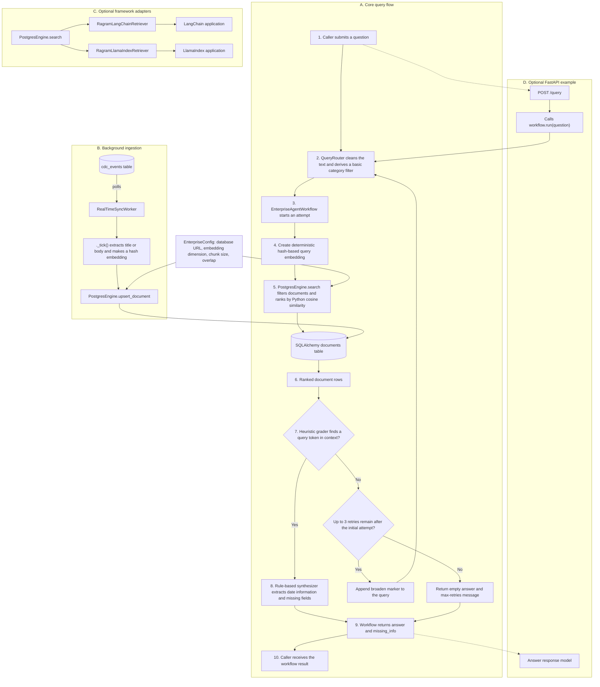

# RAGRAM Enterprise – Architecture and Request Flow

This diagram reflects the current implementation in `RagramEnterpriseEngine.py` and `integrations.py`. It distinguishes the implemented core path from the optional FastAPI example and retriever adapters.

### Legend

- **Numbers 1–10** show the core query lifecycle. The optional HTTP example is shown separately so a response is not drawn back into the request node.
- **Solid arrows** show data or control flow; **dotted arrows** show optional FastAPI entry/response mapping.
- **Cylinder** represents a database table; the decision diamond shows the grader and retry branches.
- The FastAPI block is an example entry point, not a dependency of the core workflow.

### What the current code does

1. A caller invokes the query flow; the optional FastAPI example defines a `POST /query` route.
2. `QueryRouter` uses a local heuristic to clean the question and derive a basic metadata filter. It does not call an LLM.
3. `EnterpriseAgentWorkflow` hashes the routed query into a deterministic pseudo-embedding.
4. `PostgresEngine.search` reads candidate rows, applies metadata filters, and ranks them with Python cosine-similarity calculations.
5. A token-match heuristic grades the returned rows. On a failed grade, the workflow appends `*broaden*` and reruns routing. The loop allows an initial attempt plus up to three retries; on exhaustion, the returned `retries` value is actually the number of attempts.
6. On a passing grade, the built-in synthesizer uses deterministic rules (including date extraction); it is not an LLM. Exhaustion returns an empty answer and a max-retries message with the attempt count.
7. The optional LangChain and LlamaIndex adapters independently call engine search and convert results to their respective formats.

### Implementation notes

- The worker currently polls the `cdc_events` table; a live change stream is not implemented.
- `integrations.py` contains OpenAI, Anthropic, and Ollama backend classes, but the core router and workflow do not call them.
- There is no metrics collector or Prometheus `/metrics` endpoint in the current code.
- The FastAPI example contains a route definition, but its startup wiring has not been verified as runnable. Treat it as an example until its imports and workflow construction are brought in line with the current engine API.

---

*Mermaid diagram; renderable in GitHub Markdown, VS Code, and compatible Markdown editors.*
