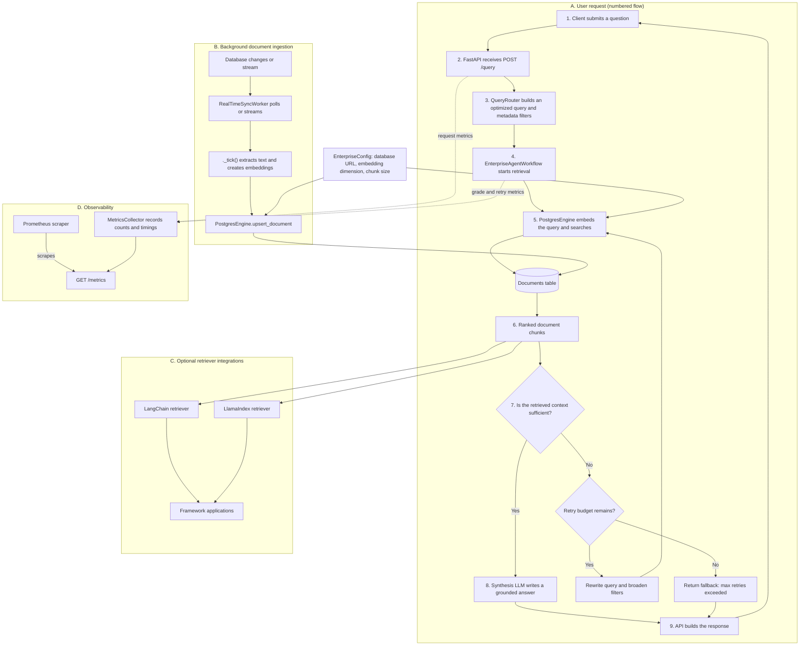

# RAGRAM Enterprise – Architecture and Request Flow

The diagram is organized around the path a question follows through the service. The numbered steps show the normal request lifecycle; the other sections show background ingestion, optional framework integrations, and observability.

### Legend

- **Numbers 1–9** identify the normal request path from the client to the response.
- **Solid arrows** show request, data, or control flow.
- **Dotted arrows** show telemetry sent to the metrics collector.
- **Cylinder** represents the shared documents store.
- **Diamond** represents a decision; the `Yes` and `No` labels show which path is taken.
- **Sections A–D** group request processing, background ingestion, optional integrations, and observability.

### Follow the request

1. The client sends a question to the FastAPI `POST /query` endpoint.
2. The API passes the question to `QueryRouter`, which produces an optimized query and metadata filters.
3. `EnterpriseAgentWorkflow` starts retrieval; `PostgresEngine` embeds the query and searches the documents table.
4. The workflow grades the ranked chunks for relevance. If the context is insufficient, it rewrites the query and retries within the configured `max_retries=3` limit.
5. If the context is sufficient, the synthesis LLM produces an answer grounded only in that context. If retries are exhausted, the workflow returns the fallback instead.
6. The API returns the result. Request and workflow metrics are recorded and exposed for Prometheus to scrape.

### Supporting components

- **Ingestion:** The background sync worker polls or streams database changes, extracts text and creates embeddings, then upserts documents into the same store used for search.
- **Framework integrations:** LangChain and LlamaIndex retrievers are optional adapters for applications using those frameworks.
- **Configuration:** `EnterpriseConfig` supplies the database URL and embedding/chunk settings to the engine.
- **Observability:** The metrics collector records counts and timings; Prometheus reads them from `GET /metrics`.

---

*Mermaid diagram; renderable in GitHub Markdown, VS Code, and compatible Markdown editors.*
