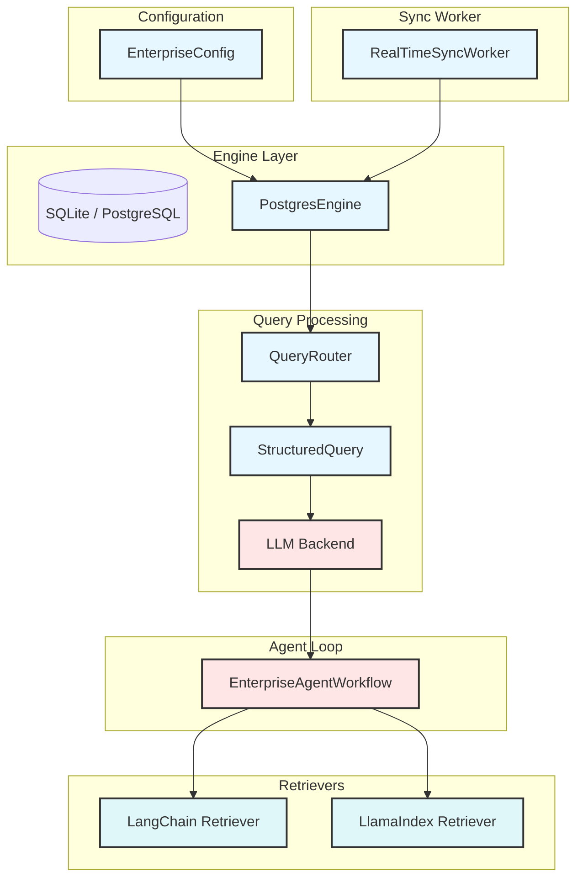

# RAGRAM Enterprise

**RAGRAM Enterprise** is an autonomous, production‑ready Advanced RAG system that hooks directly into a live, real‑time database (defaulting to PostgreSQL). It combines query translation, metadata routing, self‑correction feedback loops, and an integrated real‑time data‑ingestion sync worker to handle messy user queries and constant data drift.

---
## Table of Contents

1. [Overview](#overview)
2. [Installation](#installation)
3. [Quick Start](#quick-start)
4. [CLI Usage](#cli-usage)
5. [Python API](#python-api)
6. [Architecture](#architecture)
7. [Integration Guidelines](#integration-guidelines)
8. [Configuration](#configuration)
9. [Extending the Engine](#extending-the-engine)
10. [License](#license)

---
## Overview

RAGRAM Enterprise implements the following core components:

| Component | Description |
|-----------|-------------|
| **EnterpriseConfig** | Holds database URLs, embedding dimension, chunk‑size/overlap parameters. |
| **PostgresEngine** | SQLAlchemy/psycopg3 driver with pgvector support – unified relational + vector storage (documents, embeddings, JSON‑B metadata). |
| **RealTimeSyncWorker** | CDC‑style worker that polls a `cdc_events` table (or can be wired to a real stream) and automatically extracts text, computes embeddings, and upserts records without blocking primary traffic. |
| **StructuredQuery (Pydantic)** | Forces the LLM to output JSON containing `optimized_query` (cleaned search string) and `metadata_filters` (key/value pairs for SQL WHERE clauses). |
| **QueryRouter** | Translates raw human input → structured query → dynamic SQL executed against the `PostgresEngine`. |
| **EnterpriseAgentWorkflow** | Autonomous “retrieve‑grade‑rewrite” loop with a strict `max_retries=3` counter. |
| **Factual Synthesizer** | System‑prompted LLM that answers **only** from validated context and explicitly reports any missing data. |

The module is **stand‑alone**, **self‑contained**, and runs end‑to‑end via the `cli.py` entry point or the Python API.

---
## Architecture

The diagram below illustrates the data flow and the major subsystems.  All components communicate through well‑defined interfaces, making it easy to swap individual pieces (e.g., replace the LLM backend or the vector store) without touching the rest of the code.



### Key flows

1. **Ingestion** – `RealTimeSyncWorker` polls a `cdc_events` table (or listens to a stream) and, for each new row, extracts the text, computes an embedding (hash‑based or via a model), and calls `PostgresEngine.upsert_document` to keep the vector store up‑to‑date without blocking primary traffic.  
2. **Query routing** – `QueryRouter` forwards the user's free‑form question to an LLM via the `structured_output` prompt, which returns a JSON object containing `optimized_query` (a cleaned search string enriched with synonyms) and `metadata_filters` (key/value pairs that become SQL `WHERE` clauses such as `category`, `date`, `status`).  
3. **Search** – `PostgresEngine.search` receives the `optimized_query` embedding and the `metadata_filters`, performs a cosine‑similarity search (fallback Python computation when pgvector is unavailable), and returns the top‑k most similar documents.  
4. **Grading** – `EnterpriseAgentWorkflow._grade_context` (or an external LLM) compares the retrieved snippets against the user query; it returns **Yes** if enough relevant information is present, otherwise **No**.  
5. **Synthesis** – If the grader says **Yes**, the `synthesizer` backend (OpenAI, Anthropic, or Ollama) produces a final answer using *only* the validated context snippets; if information is missing it explicitly lists what was not found. If the grader says **No**, the loop records the failure reason, appends “*broaden*” to the query, clears the metadata filters, and retries (up to `max_retries=3`).  
6. **Retrievers** – The LangChain retriever (`RagramLangChainRetriever`) and the LlamaIndex retriever (`RagramLlamaIndexRetriever`) wrap the engine's `search` method and expose results in their respective formats (`Document` objects or `NodeWithScore`), allowing integration with respective agent frameworks.  
7. **API exposure** – The FastAPI service (`examples/fastapi_app.py`) exposes a single POST `/query` endpoint; the request body contains `{ "question": "..." }` and the response is `{"answer": "...", "missing_info": "...", "retries": N}`.

---
## Installation

```bash
# 1️⃣  Clone the repository (or copy the files)
git clone https://github.com/your‑org/RAGRAM_Enterprise.git
cd RAGRAM_Enterprise

# 2️⃣  Install the required dependencies
pip install -r requirements.txt
```

`requirements.txt` contents:

```
pydantic>=2.5
sqlalchemy>=2.0
psycopg[binary]>=3          # optional – only needed for a real PostgreSQL server
sentence-transformers>=2.2  # optional – for real embeddings
```

> **Optional extras** (install only what you need):
* `langchain-core` – for the LangChain retriever.
* `llama-index-core` – for the LlamaIndex retriever.
* `openai` – for OpenAI generation backend.
* `anthropic` – for Anthropic generation backend.
* `fastapi` & `uvicorn` – for the FastAPI demo service.

---
## Quick Start (demo mode – SQLite)

```bash
python cli.py --seed --query "What were the sales figures for the Q3 period and can you tell me about any product launches that happened around the same time?"
```

* `--seed` creates a mock `cdc_events` table with sample rows.
* `--query` supplies the user question; if omitted a default ambiguous query is used.

You should see output similar to:

```
=== User Query ===
What were the sales figures for the Q3 period and can you tell me
about any product launches that happened around the same time? Also,
did the board approve any budget changes in 2024?

--- Running EnterpriseAgentWorkflow ---

[Workflow] Attempt 1/3
[Workflow] Grader said 'Yes' (attempt 1).

=== Final Result ===
{
  "answer": "The records concern the date 2024-09-01.",
  "missing_info": null,
  "retries": 1
}
[Engine] Demo completed.
```

If the grader returns **“No”**, the loop automatically rewrites the query, loosens filters, and retries (up to three times) before reporting “Max retries exceeded”.

---
## CLI Usage

```bash
python cli.py [OPTIONS]

Options:
  --db-url TEXT        SQLAlchemy database URL (default: sqlite:///RAGRAM_Data/demo.db)
  --seed               Populate a mock cdc_events table (useful for demo)
  --query TEXT         User query to run through the workflow (default: built‑in ambiguous query)
  --help               Show this message and exit
```

### Examples

```bash
# Run with a custom query
python cli.py --query "Summarize the Q3 budget changes and any product launches"

# Connect to a real PostgreSQL instance
python cli.py --db-url "postgresql+psycopg3://user:pw@host:5432/mydb" --seed
```
---
## Python API

```python
from RagramEnterpriseEngine import (
    EnterpriseConfig,
    PostgresEngine,
    RealTimeSyncWorker,
    QueryRouter,
    EnterpriseAgentWorkflow,
)

# 1️⃣  Configure the engine
cfg = EnterpriseConfig(db_url="sqlite:///:memory:")       # or a real PostgreSQL URL
engine = PostgresEngine(cfg)

# 2️⃣  (Optional) seed CDC events for the sync worker
with engine._engine.begin() as conn:
    # ... add CdcEvent rows as shown in the source ...

# 3️⃣  Start the sync worker in a background thread
worker = RealTimeSyncWorker(engine, poll_interval=0.5)
t = threading.Thread(target=worker.start, daemon=True)
t.start()

# 4️⃣  Build the router and workflow
router = QueryRouter(engine)
workflow = EnterpriseAgentWorkflow(engine, router, top_k=3)

# 5️⃣  Run a user query
result = workflow.run(
    "What were the sales figures for the Q3 period and any product launches around the same time?"
)
print(json.dumps(result, indent=2))
```

The `run` method returns a dict with keys:

* `answer` – the synthesized factual answer (or empty string if failed)
* `missing_info` – `None` if the answer is complete, otherwise a semicolon‑separated list of missing pieces
* `retries` – how many times the self‑correction loop executed (≤ 3)

---
## Architecture (detail)


### Flow summary

1. **Ingestion** – `RealTimeSyncWorker` → `PostgresEngine.upsert_document`.  
2. **Query routing** – `QueryRouter` → LLM → `StructuredQuery`.  
3. **Search** – `PostgresEngine.search` → top‑k documents.  
4. **Grading** – `EnterpriseAgentWorkflow._grade_context`.  
5. **Synthesis** – if “Yes”, `synthesizer` produces answer; else loop back.  
6. **Retrievers** – LangChain / LlamaIndex wrappers expose the same docs.  
7. **API** – FastAPI `/query` endpoint runs the whole loop.

---
## Integration Guidelines

| Goal | How to enable |
|------|---------------|
| **LangChain retriever** | `from integrations import RagramLangChainRetriever; retriever = RagramLangChainRetriever(engine)` – used as any `langchain_core.retrievers.BaseRetriever`. |
| **LlamaIndex retriever** | `from integrations import RagramLlamaIndexRetriever; retriever = RagramLlamaIndexRetriever(engine)` – returns `NodeWithScore` objects. |
| **OpenAI generation** | Set `OPENAI_API_KEY` and `RAGMA_BACKEND=openai` in `.env`. The workflow will use `OpenAIGeneration` for structured output, grader, and synthesizer. |
| **Anthropic generation** | Set `ANTHROPIC_API_KEY` and `RAGMA_BACKEND=anthropic`. |
| **Ollama local LLM** | Ensure Ollama is running (`ollama serve`). No extra pip packages needed – the backend uses only `urllib.request`. Set `RAGMA_BACKEND=ollama` and `OLLAMA_URL=http://localhost:11434`. |
| **FastAPI service** | Run `cd examples && uvicorn fastapi_app:app --reload`. POST `{"question": "your query"}` to `http://127.0.0.1:8000/query`. |
| **Custom LLM backend** | Implement `GenerationBackend` (ABC) and register it in `load_backend()` or pass an instance directly to `EnterpriseAgentWorkflow`. |

---
## Configuration

| Setting | Default | Description |
|---------|---------|-------------|
| `db_url` | `"sqlite:///RAGRAM_Data/demo.db"` | SQLAlchemy URL. Use `postgresql+psycopg3://user:pw@host:5432/dbname` for production. |
| `embedding_dim` | `768` | Dimensionality of the embedding vectors. |
| `chunk_size` | `1000` | Max characters per text chunk. |
| `chunk_overlap` | `200` | Overlap between consecutive chunks. |

You can also pass a custom `db_url` via the CLI (`--db-url`) or directly when constructing `EnterpriseConfig`.

---
## License

This project is released under the **MIT License**. Feel free to use, modify, and distribute it commercially or non‑commercially, provided the original copyright notice is retained.

---
*Happy RAG‑ming! 🚀*